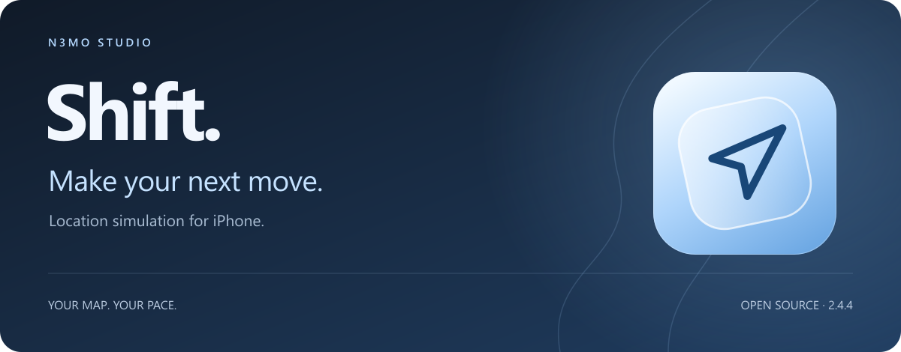
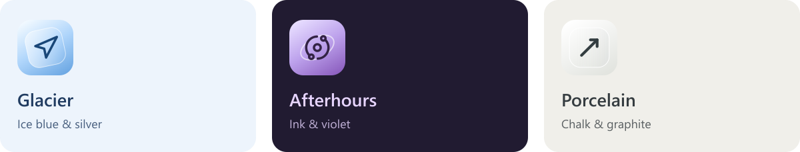

  

<strong>2.4.4 · iOS 18+ · SwiftUI · MIT licensed</strong>

  <a href="SETUP.md">Get started</a> &nbsp;·&nbsp;
  <a href="CHANGELOG.md">Changelog</a> &nbsp;·&nbsp;
  <a href="docs/BUILDING.md">Build from source</a> &nbsp;·&nbsp;
  <a href="CONTRIBUTING.md">Contribute</a>

**Your map. Your pace.** Shift is an independent, open-source evolution of
[Locus](https://github.com/ChrisMack32/Locus): a location simulator for iPhone
with native map controls, a personal library, and three distinct looks.

## Make your next move

- **Pick a place.** Search, preview a pin, fine-tune its position, then teleport.
- **Make a route.** Use directions, tap points, draw freehand, or import GPX. Add stops, waits, and travel speeds; preview before starting.
- **Move your way.** A map-relative joystick, pause/resume, route jumps, and an explicit Stop spoofing action.
- **Keep your places.** Named areas, folders, saved trips, edit history, Recently Deleted, and library export/import.
- **Stay informed.** Live Activities, Dynamic Island, Home Screen shortcuts, and status based on recent command evidence.

## Choose your atmosphere

Each style has light and dark palettes. Pick any of **nine app icons** independently
of your interface style. Native Liquid Glass adapts to supported iOS versions
and accessibility settings.

## The latest

The 2.4 series adds the three appearance families and independent icon choices,
fixes a first-launch appearance crash, and refreshes native tab navigation and
system icon resources. **2.4.4 removes the temporary notification-preview tool.**

[Everything since the original Locus base](CHANGELOG.md)

## Get Shift

Download the IPA from this repository’s **Releases**, then sign and install it
through SideStore. Keep the app extension. Updating an existing installation?
Use the same signing setup and install over it.

First use needs compatible device pairing and LocalDevVPN. The minimum deployment
target is iOS 18; compatibility still depends on the device, iOS version, and
signing setup. [Follow the short setup guide →](SETUP.md)

Optional [cloud](CloudFindMy/RENDER-SETUP.txt) and
[Windows](Companion/README.txt) helpers can compare Find My **Devices** reports.
Each person supplies their own helper address and credentials. No shared server
or account is included. These unofficial integrations may stop working.

## Know what the status means

A successful location command is not proof of what another app or person sees.
Apple can return old Find My reports, and iOS controls background execution and
notification delivery. Shift shows missing evidence as unverified. Battery savings
and continuous background operation are not guaranteed.

[Privacy and limitations](docs/PRIVACY.md) · [Validation and device checks](docs/TESTING.md)

## Open to everyone

Use it, change it, share it, sell a fork, or help make it better. **No permission
or heads-up required.** Keep the applicable copyright and license notices.
The software is provided **as is**, without warranty, under the [MIT license](LICENSE).

Made by **N3mo Studio**, built on work by the **Locus contributors**,
[idevice](https://github.com/jkcoxson/idevice), and [Lucide](https://lucide.dev).
[Full credits and notices](NOTICE.md). Independent of Apple and the upstream projects.
